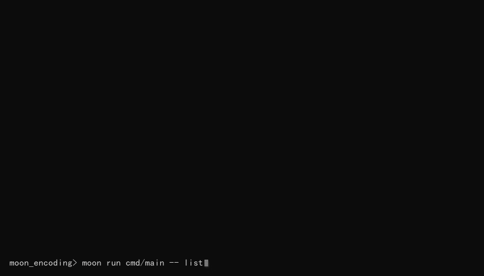

# moon_encoding

[](https://github.com/LL728/moon_encoding/actions/workflows/ci.yml)

WHATWG Encoding Standard 的 MoonBit 实现：完整的 label 解析（228 个）、
流式解码 API、一次性编码 API 与文件转码命令行工具，覆盖该标准定义的全部 40 种编码。

数据表直接由 [whatwg/encoding](https://github.com/whatwg/encoding) 的规范源数据生成
（固定版本 `2c3853e`，与 Rust `encoding_rs` 的表生成同源），不经过任何二手实现。

## 编码覆盖状态

WHATWG Encoding Standard 共定义 40 种编码、228 个 label。
**40 种编码全部接线**（label 解析 + 解码 + 编码；规范未定义编码器的三种除外，见下）：

| 分组 | 编码 | 状态 |
| --- | --- | --- |
| 单字节（28 种） | `windows-1252`（含 `latin1` / `ascii` 等别名）、`ISO-8859-2/3/4/5/6/7/8/8-I/10/13/14/15/16`、`windows-874/1250..1258`、`KOI8-R/U`、`IBM866`、`macintosh`、`x-mac-cyrillic` | ✅ 已实现 |
| 中文 | `GBK`（含 `gb2312` / `chinese` 等别名）、`gb18030`（含 4 字节） | ✅ 已实现 |
| 日文 | `Shift_JIS`、`ISO-2022-JP`（7 状态转义状态机 + 跨块状态） | ✅ 已实现 |
| 日文 / 韩文 | `EUC-JP`（含 SS2/SS3）、`EUC-KR` | ✅ 已实现 |
| 中文（繁体） | `Big5` | ✅ 已实现 |
| Unicode | `UTF-8`、`UTF-16BE`、`UTF-16LE`（仅解码，见下） | ✅ 已实现 |
| 其他 | `replacement`（至多一个 U+FFFD）、`x-user-defined`（算法定义，无索引表） | ✅ 已实现 |

规范不定义 `replacement` 与 `UTF-16BE`/`UTF-16LE` 的**编码器**（`§get an encoder` 断言），
对它们调用 `encode` 会返回明确的 `UnsupportedEncoding` 错误（而不是静默失败）；
未知 label 返回 `UnknownLabel`——两者可区分。

## 与 MoonBit 生态现有实现的关系

Mooncakes 上已有 [`f4ah6o/encoding_sjis`](https://mooncakes.io/docs/f4ah6o/encoding_sjis)
（Shift_JIS 解码器，Apache-2.0）等单编码实现。为避免"功能重叠"的歧义，明确如下：

- **复用关系：无依赖、无代码复用。** 本库依赖清单只有 `moonbitlang/core` 与
  `moonbitlang/x`（CLI 文件读写），不含 `encoding_sjis`；Shift_JIS 部分按 `encoding.bs`
  （whatwg/encoding @ `2c3853e`）逐条独立实现，数据表由规范源数据生成。两者只是
  数据上游同源（WHATWG 规范），代码路径完全不同。
- **重叠范围：** 交集只有"Shift_JIS 解码（含跨块流式、U+FFFD 替换）"这一项能力。
  **流式解码并非本库独有**，`encoding_sjis` 同样提供流式解码——本库的增量在覆盖范围与编码方向，如下表。
- **扩展关系：** 本库在重叠项之外扩展的是编码方向与全集覆盖：

| 维度 | `f4ah6o/encoding_sjis` | 本库 `moon_encoding` |
| --- | --- | --- |
| 编码范围 | 仅 Shift_JIS 一种 | 40 种编码 / 228 个 label 全部接线（编解码；规范未定义编码器的三种除外） |
| 方向 | 仅解码（无编码端） | 解码 + 编码（fatal 模式），含 Shift_JIS / ISO-2022-JP 编码器 |
| 流式解码 | ✅ `new_decoder` / `decode_to_string` | ✅ `Decoder::new` / `consume` / `finish`，统一覆盖全部已接线编码（含 ISO-2022-JP 的转义与双字节跨块） |
| 合规基准 | encoding_rs-compliant（自述） | WHATWG `encoding.bs` 逐条实现 |
| 附加能力 | — | 28 种单字节编码、GBK/gb18030、Big5、EUC-JP/EUC-KR、ISO-2022-JP、replacement/x-user-defined、UTF-8/UTF-16、CLI 转码、CPython 差分测试 |

## 安装

```bash
moon add LL728/moon_encoding
```

库本身只依赖 `moonbitlang/core`（随工具链自带）。

## 使用

### 一次性解码 / 编码

导入声明放在 `moon.pkg`（MoonBit 不在 `.mbt` 文件内解析 `import`）：

```moonbit
// moon.pkg
import {
  "LL728/moon_encoding",
  "moonbitlang/core/debug",
}
```

`.mbt` 中使用：

```moonbit
pub fn example(bytes : Bytes) -> Unit {
  // 字节 -> 文本（解码错误按规范替换为 U+FFFD）
  match @moon_encoding.decode(bytes, "windows-1252") {
    Ok(text) => println(text)
    Err(e) => println("解码失败: " + @debug.to_string(e))
  }
  // 文本 -> 字节（fatal 模式：不可映射字符直接报错）
  match @moon_encoding.encode("Héllo €", "windows-1252") {
    Ok(out) => println("\{out.length()} 字节")
    Err(e) => println("编码失败: " + @debug.to_string(e))
  }
}
```

### 流式解码

```moonbit
// chunk : Bytes —— 逐块到达的字节
match @moon_encoding.Decoder::new("windows-1252") {
  Ok(decoder) => {
    let mut text = ""
    text = text + decoder.consume(chunk) // 跨块状态在解码器内维护，任意切分结果一致
    text = text + decoder.finish()
  }
  Err(e) => println("创建解码器失败: " + @debug.to_string(e))
}
```

### 错误类型

```moonbit
pub enum EncodingError {
  UnknownLabel(String)           // label 不在标准定义的 228 个之内
  UnsupportedEncoding(String)    // label 合法但规范未定义编码器（replacement / UTF-16BE / UTF-16LE）
  Unmappable(Int, Int)           // 编码遇不可映射字符：码点 + 字符位置
} derive(Eq, @debug.Debug)
```

错误语义对齐 WHATWG 规范（`encoding.bs`）：解码为 **replacement** 模式
（错误字节 → U+FFFD），编码为 **fatal** 模式（规范的 `encode or fail` 操作，
替换策略交还调用方）。

## 命令行

```bash
# 字节 -> UTF-8 文本
moon run cmd/main -- decode <label> <input> <output>
# UTF-8 文本 -> 目标编码字节
moon run cmd/main -- encode <label> <input> <output>
# 列出本构建支持的全部编码（WHATWG 规范名）
moon run cmd/main -- list

# 示例
moon run cmd/main -- decode windows-1252 legacy.txt utf8.txt
moon run cmd/main -- encode latin1 utf8.txt legacy.txt
moon run cmd/main -- list
```

失败一律以非零退出码结束并打印原因，便于脚本使用：

```text
$ moon run cmd/main -- encode replacement in.txt out.bin
编码失败: UnsupportedEncoding("replacement")
$ echo $?
1
```

## 演示



演示覆盖：编码清单（40 种）、GBK/gb18030 往返、Big5/Shift_JIS/EUC-JP/EUC-KR/
UTF-16 解码、ISO-2022-JP 的日本語解码 + 编码往返（编码端用 label 别名 `csiso2022jp`）、
x-user-defined 解码、三类错误路径（未知 label、不可映射字符、规范未定义编码器的
replacement / UTF-16）与全量测试收尾。

- 同步生成的文字实录：[docs/demo_transcript.txt](docs/demo_transcript.txt)
  （含每条命令的完整输出与退出码，作为 GIF 内容未被加工的凭据）
- 重新生成：`python tools/make_demo.py`——每帧文字都来自真实执行的命令，
  脚本内置自检，输出与期望不符即失败；行为变化后应重新生成，避免演示与实现脱节

## 验证方式

`moon test` **165 项**，在 wasm-gc 与 js 两个后端上全绿；CI 每次提交都跑格式检查、
`moon check --deny-warn`、构建、双后端测试、生成物新鲜度与命令行端到端。

- **单元与属性测试**：label 解析、28 张表的结构不变量（128 项解码表、合法非代理码点、
  编码表严格升序唯一）、规范已知映射、windows-1252 的 256 字节全量双向往返、
  全部表项的逐项往返、28 张表共 150 个解码错误位经公共 API 输出 U+FFFD 的
  replacement 接线、1200 组随机切分的流式等价性；
  GBK/gb18030 的规范锚点（0x80→U+20AC、4 字节公式、U+E7C7 特例、18 条 PUA 侧表及其
  **刻意不对称**行为）、三条 Restore 重放路径、end-of-queue 单 U+FFFD、
  每个切分点 + 1200 组随机切分的跨块等价、1,087,996 个合法 4 字节 pointer 全量扫描；
  Big5 的 4 条双码点命名序列、六个"取最后出现"码点、过滤（pointer ≥ 5024）与
  ASCII 尾字节重放；Shift_JIS 的 0x80 单字节往返、半角片假名、EUDC PUA 区间
  （U+E000..U+E757）、¥→0x5C / U+2212→U+FF0D 特例、NEC 行排除；
  EUC-JP 的 SS2/SS3 前缀与 jis0212 标志复位、EUC-KR 的空位重放（81 5B → U+FFFD + '['）
  与 81 41 → U+AC02 数据锚点、两者 fresh 字节 0x80 报错（对比 GBK/Shift_JIS 的差异）、
  EUC-JP 编码反向表全部指针 < 8836（规范注记）的全表断言；
  UTF-8 的非法延续字节状态复位 + 重放（E1 80 41 → U+FFFD + 'A'）、
  过长/代理区头拒绝（C0 80、E0 80 80、ED A0 80 各自的 U+FFFD 个数）、
  截断单 U+FFFD；UTF-16 孤立低代理报错、未配对高代理的**当前码元重放**
  （00D8 4100 → U+FFFD + 'A'，字符不丢）、BOM 按 U+FEFF 输出、
  以及 UTF-16 编码按规范返回 UnsupportedEncoding；
  ISO-2022-JP 的 **7 状态 + 4 变量**逐条行为（5 条转义序列、katakana 状态不查表、
  output 布尔量导致的"连续转义报错"、output state 让非法转义退回原模式）、
  Trailing byte 非法第二字节**被吞掉不回退**（对比 EUC-KR 会回放 ASCII 字节）、
  7 种状态的 end-of-queue 行为（Escape 会把 0x24/0x28 放回队列 → `U+FFFD U+0024`）、
  编码器的 U+000E/U+000F/U+001B → `Unmappable(U+FFFD, 位置)`、U+2212→U+FF0D、
  半角片假名经 `index ISO-2022-JP katakana` 转全角、规范自己的
  "¥ 编码两次拼接后解码得 ¥ U+FFFD ¥" 注记；
  **跨块状态**：转义序列 / 双字节字符 / ESC 切在任意位置、逐字节喂入、每个切分点
  （含 0 与 n）+ 1200 组随机多切分均等于一次性 `decode()`；
  replacement 的"至多一次 U+FFFD 后整体 finished"（256 字节也只有 1 个 U+FFFD）、
  x-user-defined 的 256 字节恒等/偏移与全量双向往返；
  228 个 label 的端到端生成套件（逐个解析 + 解码器可构造 + 编码可达性）。
- **Python 差分测试**：以 CPython 各编码的 codec 为独立预言机，
  **8500+ 黄金向量**由 `tools/gen_vectors.py` 生成并提交进仓库，覆盖 28 种单字节编码、
  GBK/gb18030、Big5/Shift_JIS、EUC-JP/EUC-KR 与 UTF 三件套。分类按编码**逐样本自动
  计算**（规范参考实现在 `tools/chinese_ref.py` / `multibyte_ref.py` / `utf_ref.py`，
  与表生成器同源）：两边同值才进向量，两边都报错由 U+FFFD 单测覆盖，有分歧则排除并
  逐编码计数——windows-1252 的 `0x81/8D/8F/90/9D`（CPython 报错、WHATWG 映射 C1）、
  EUC-JP 的 57 处 JIS 表格差异、UTF-16 各三百余次 strict 跳过都在其中；
  分歧清单不写死，UTF-16 只有解码向量（规范不定义其编码器）。
  `ISO-2022-JP` / `replacement` / `x-user-defined` **不进差分向量**：CPython 的
  `iso2022_jp` 在这三处与规范系统性分歧（拒绝 `ESC ( I`、把 0x0E/0x0F 当普通字符、
  拒绝半角片假名、转义后强制回 ASCII），按"规范优先"原则改由
  `iso2022_wbtest.mbt` / `misc_wbtest.mbt` 的规范级单测逐条钉住。
- **新鲜度检查**：CI 重新生成全部表与向量后 `git diff --exit-code`，
  保证提交内容永远等于生成器产物。

```bash
python tools/generate_tables.py   # 由 vendored 规范数据生成 label/编码表/dispatch
python tools/gen_vectors.py       # 由 CPython codecs 生成差分向量
moon fmt && moon check --deny-warn && moon test
```

## 代码结构

| 文件 | 职责 |
| --- | --- |
| `label.mbt` | label 解析入口（ASCII 大小写不敏感匹配） |
| `single_byte.mbt` | 28 种单字节编码共用的表驱动编解码引擎 |
| `codec.mbt` | 公共 API：`EncodingError`、流式 `Decoder`、`decode` / `encode` |
| `gbk.mbt` | GBK/gb18030 状态机与编码器（规范 §gb18030-decoder/encoder 逐条实现） |
| `utf.mbt` | UTF-8 / 共享 UTF-16 状态机与 UTF-8 编码器（规范 §utf-8 / §shared-utf-16 逐条实现） |
| `euc.mbt` | EUC-JP / EUC-KR 状态机与编码器（规范 §euc-jp / §euc-kr 逐条实现） |
| `multibyte.mbt` | Big5 与 Shift_JIS 状态机与编码器（规范 §big5 / §shift_jis 逐条实现） |
| `iso2022.mbt` | ISO-2022-JP 的 7 状态解码器（4 个关联变量）与编码器（规范 §iso-2022-jp-decoder / encoder 逐条实现） |
| `misc.mbt` | replacement 解码器（至多一次 error）与 x-user-defined 的算法合成表 |
| `gen_label.mbt` / `gen_single_byte.mbt` / `gen_chinese.mbt` / `gen_big5_sjis.mbt` / `gen_euc.mbt` / `gen_iso2022.mbt` | 生成物：label 表、单字节表、gb18030 与 Big5/jis0208/EUC/ISO-2022-JP katakana 各索引与编码反向表（勿手改） |
| `gen_w1252_vectors_wbtest.mbt` | 生成物：CPython 差分黄金向量（勿手改） |
| `cmd/main/` | 文件转码 CLI |
| `tools/` | 规范数据 vendor、表与差分向量生成器、规范参考实现（`chinese_ref.py`、`multibyte_ref.py`、`utf_ref.py`，encode-map 规则单一来源） |

## 已知限制

- 已实现范围为规范全部 40 种编码（28 种 legacy 单字节 + `GBK` / `gb18030` / `Big5` /
  `Shift_JIS` / `EUC-JP` / `EUC-KR` / `ISO-2022-JP` / `UTF-8` / `UTF-16BE` / `UTF-16LE` /
  `replacement` / `x-user-defined`，`supported_encodings()` 可查询 40 个规范名）。
- **规范不定义 `replacement` 与 `UTF-16` 的编码器**（`§get an encoder` 断言 encoding
  不是 replacement 或 UTF-16BE/LE）：`encode(..., "replacement" / "utf-16le" / "utf-16be")`
  如实返回 `UnsupportedEncoding`，解码不受影响。
- 未实现 BOM 嗅探与 `decode()` 的自动 BOM 覆写；label 由调用方显式给出。
  因此 UTF-16 输入里的 BOM 会作为 U+FEFF 字符解出（与 CPython 的
  `utf-16-be` / `utf-16-le` 行为一致）。
- 编码侧只提供 fatal 模式原语；规范中 HTML 表单用的 `&#码点;` 替换模式（html 模式）
  尚未提供。
- 单字节编码与 x-user-defined 无跨块状态（replacement 只跨块保留"是否已报过 error"
  两个布尔量）；多字节编码（GBK/Big5/Shift_JIS/EUC/ISO-2022-JP/UTF-16）的挂起状态
  保存在解码器内跨块续传，任意切分等价由"每个切分点 + 随机切分"测试覆盖。

## 参考与许可

- 代码采用 [Apache-2.0](LICENSE)。
- 数据表源自 [WHATWG Encoding Standard](https://encoding.spec.whatwg.org/)，
  © WHATWG (Apple, Google, Mozilla, Microsoft)，按 [BSD 3-Clause](LICENSE-WHATWG) 授权
  （规范仓库 LICENSE 文件原文说明：并入源码的部分以 BSD-3-Clause 授权）。
- 表生成流程参考 [encoding_rs](https://github.com/hsivonen/encoding_rs) 的
  `generate-encoding-data.py`（同为 `(Apache-2.0 OR MIT)`，本项目未移植其代码，
  仅沿用其钉定的 whatwg/encoding 版本以保证数据同源）。
- 差分预言机：CPython 标准库 `codecs` 的各编码实现（`cp1252`、`gbk`、`big5`、
  `shift_jis`、`euc_jp`、`euc_kr`、`utf-8`、`utf-16-le` 等，PSF 许可）；
  `iso2022_jp` 因与规范存在系统性分歧，只作为人工对照、不进入黄金向量。
